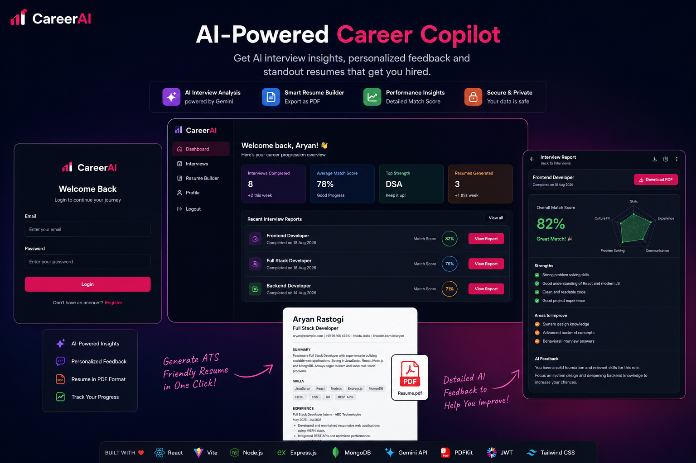
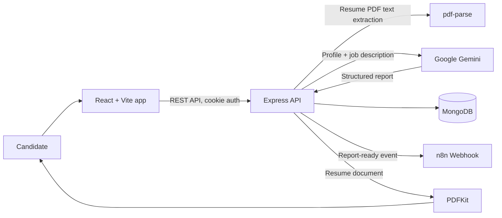

# CareerAI

**Role-specific interview preparation and resume tailoring for placement candidates.** CareerAI compares a candidate profile with a target job description, then builds a practical preparation plan: a role match estimate, skill gaps, technical and behavioral practice questions, a seven-day roadmap, and an optional tailored resume PDF.

<p align="center">
  
</p>

CareerAI is a candidate preparation product. Its match score is an AI-generated estimate for reflection and practice; it is not a recruiter decision, an ATS ranking, or a guarantee of selection.

## What candidates can do

- Create an account and keep interview plans in a personal workspace.
- Paste a job description and provide a profile using a PDF resume, a short self-description, or both. PDF uploads are limited to 5 MB.
- Review an AI-generated role match estimate and skill gaps, including gap severity.
- Practice role-specific technical and behavioral questions with interviewer intent and sample answers.
- Follow a generated seven-day preparation roadmap.
- Generate and download an ATS-friendly resume PDF tailored to the target role.
- Search saved plans by job title, pin plans for later, and delete plans.
- Switch the interface theme.

### Placement and recruiter perspective

For placement candidates, the workflow turns a job posting into concrete preparation tasks and helps make relevant experience easier to explain. Candidates should verify generated answers and resume content against their real experience before using them in an interview or application.

For recruiters and placement reviewers, CareerAI demonstrates a role-alignment workflow: job requirements are compared with candidate-provided evidence, gaps are surfaced, and interview preparation is organized into a readable report. The current product is candidate-facing; it does not provide recruiter accounts, candidate search, hiring decisions, or an employer dashboard. The match score is not an objective assessment of candidate quality.

The project also showcases practical full-stack skills relevant to entry-level roles: a feature-based React app, REST APIs, MongoDB persistence, cookie-based authentication, schema-validated Gemini output, PDF processing and generation, and a signed n8n webhook integration.

## How it works



1. The candidate signs in and submits a job description plus a resume PDF and/or self-description.
2. The backend extracts text from the uploaded PDF in memory and sends the profile and job description to Gemini.
3. Gemini returns structured report data. The backend validates the response, saves the report in MongoDB, and returns it to the app.
4. The candidate reviews questions, skill gaps, the preparation roadmap, and can request a tailored resume PDF.
5. After saving a report, the backend can post a signed report-ready event to an n8n Webhook.

## Technology

| Area | Current implementation |
|---|---|
| Frontend | React 19, Vite, React Router, Axios, Sass |
| Backend | Node.js, Express 5, REST endpoints, cookie parsing and CORS |
| Data | MongoDB with Mongoose |
| AI | Google GenAI SDK (`@google/genai`), configured for `gemini-3.6-flash`; Zod validates structured output |
| Authentication | bcryptjs password hashing, JWT in an HTTP-only cookie, token blacklist on logout |
| Resume processing | Multer memory storage and `pdf-parse` for uploaded PDFs |
| Resume output | PDFKit generates the downloadable PDF from AI-structured resume content |
| Automation | Optional signed HTTP event to an n8n Webhook |

## Repository structure

```text
CareerAI/
├── Backend/
│   ├── server.js
│   └── src/
│       ├── config/       # MongoDB connection
│       ├── controllers/  # Auth and interview report handlers
│       ├── middleware/  # Cookie auth and in-memory file upload
│       ├── models/      # Users, reports, and blacklisted tokens
│       ├── routes/      # /api/auth and /api/interview
│       └── services/    # Gemini, n8n, and PDF generation
├── Frontend/
│   ├── src/features/
│   │   ├── auth/        # Registration, login, auth state
│   │   └── interview/   # Plan creation, saved plans, report views
│   ├── public/
│   └── vercel.json      # SPA fallback and /api rewrite
├── docs/
│   └── careerai-preview.png
└── Readme.md
```

## Run locally

### Prerequisites

- Node.js 20.19 or later and npm
- A reachable MongoDB database
- A Google AI Studio API key for Gemini
- n8n only if you want report-ready automation

### 1. Configure the backend

From the repository root:

```bash
cd Backend
npm install
```

Create `Backend/.env` with the required settings:

```env
PORT=3000
NODE_ENV=development
MONGO_URI=mongodb://127.0.0.1:27017/careerai
JWT_SECRET=replace-with-a-long-random-secret
GOOGLE_GENAI_API_KEY=your-google-ai-studio-api-key
FRONTEND_URLS=http://localhost:5173
```

`FRONTEND_URLS` is a comma-separated allowlist used by the backend CORS configuration. Add each frontend origin that should be allowed to make credentialed API requests.

Start the backend:

```bash
npm start
```

The API listens on port `3000` by default. It connects to MongoDB before accepting requests. The health endpoint is `http://localhost:3000/health`. The backend package's `dev` script calls `nodemon`, which is not currently declared as a dependency; use `npm start` for a clean install.

### 2. Configure and start the frontend

In a second terminal:

```bash
cd Frontend
npm install
```

Create `Frontend/.env.local`:

```env
VITE_API_URL=http://localhost:3000
```

Start Vite:

```bash
npm run dev
```

Open the local URL printed by Vite (usually `http://localhost:5173`). The frontend sends credentialed requests to the backend; keep the frontend origin in `FRONTEND_URLS`.

### Frontend scripts

Run these from `Frontend/`:

| Command | Purpose |
|---|---|
| `npm run dev` | Start the Vite development server |
| `npm run build` | Build the frontend for deployment |
| `npm run preview` | Preview a production build locally |
| `npm run lint` | Run ESLint |

## n8n report-ready automation

The backend posts an `interview.report.created` event after it saves each interview report. An n8n workflow can use the event to send a report-ready email or perform another follow-up action. The application itself does not send email; delivery depends on the workflow and its email provider.

Add these settings to `Backend/.env` to enable the webhook:

```env
FRONTEND_URL=http://localhost:5173
N8N_REPORT_READY_WEBHOOK_URL=https://your-n8n-host/webhook/careerai/report-ready
N8N_REPORT_READY_JWT_SECRET=use-a-separate-long-random-secret
```

Configure an n8n Webhook node to accept `POST` requests at `careerai/report-ready`, require JWT authentication using HS256 and the same passphrase as `N8N_REPORT_READY_JWT_SECRET`, and respond immediately. Use the node's test URL while testing, then configure its production URL after activating the workflow.

The signed request carries a short-lived bearer token (60 seconds) and a JSON body similar to:

```json
{
  "event": "interview.report.created",
  "eventId": "report-ready:<reportId>",
  "recipientEmail": "candidate@example.com",
  "userId": "<userId>",
  "reportId": "<reportId>",
  "title": "Frontend Engineer",
  "matchScore": 78,
  "reportUrl": "http://localhost:5173/interview/<reportId>"
}
```

The webhook payload contains report metadata and the recipient email; it does not include the resume text, self-description, job description, or generated answers. The report URL is protected by sign-in. The event is currently sent for every saved report; an email opt-in preference is not wired into the current user model or frontend. Webhook delivery is fire-and-forget: a failed request is logged, but report creation continues and the backend does not retry it.

## API overview

Protected endpoints require the authentication cookie.

| Method | Endpoint | Access | Purpose |
|---|---|---|---|
| `GET` | `/health` | Public | Backend and MongoDB readiness |
| `POST` | `/api/auth/register` | Public | Create an account |
| `POST` | `/api/auth/login` | Public | Sign in |
| `POST` | `/api/auth/logout` | Public | Clear cookie and blacklist the current token |
| `GET` | `/api/auth/get-me` | Protected | Get the signed-in user |
| `POST` | `/api/interview` | Protected | Generate a report; multipart fields `jobDescription`, optional `selfDescription`, optional PDF field `resume` |
| `GET` | `/api/interview` | Protected | List the user's saved reports |
| `GET` | `/api/interview/report/:interviewId` | Protected | Fetch one owned report |
| `PATCH` | `/api/interview/report/:interviewId/pin` | Protected | Pin or unpin a report (`{ "isPinned": true }`) |
| `DELETE` | `/api/interview/report/:interviewId` | Protected | Delete an owned report |
| `POST` | `/api/interview/resume/pdf/:interviewReportId` | Protected | Generate and download a tailored PDF resume |

The job description is required. The request must include a resume PDF or a non-empty self-description. Uploaded PDFs are limited to 5 MB.

## Data, security, and scope

- Passwords are hashed with bcryptjs. The signed JWT is stored in an HTTP-only cookie and expires after one day. Logout blacklists the token and clears the cookie.
- Resume PDFs are accepted into memory for text extraction; the original uploaded file is not written to disk. The extracted resume text, self-description, job description, and generated report are stored in MongoDB with the report.
- Candidate profile and job-description content is sent to Google's Gemini API to generate the report and resume content. Review Google's terms and data settings before using sensitive candidate information.
- The n8n event shares only the report metadata and recipient email described above. Keep its JWT secret separate from `JWT_SECRET` and store secrets as deployment environment variables.
- Generated match scores, skill-gap labels, questions, answers, and resume wording can be incomplete or incorrect. Candidates should verify every claim and should not present AI-generated content as experience they do not have.
- The email-preferences route is present in the backend, but the current user schema does not persist that field and the frontend has no preference control. The n8n event therefore currently runs without an in-app opt-in setting.

## Deployment note

`Frontend/vercel.json` contains a Vercel SPA fallback and rewrites `/api/*` requests to the Render backend URL configured in that file. For another deployment, update that destination or set `VITE_API_URL` to the backend origin, and configure the backend's `FRONTEND_URLS` with the deployed frontend origin.

## License

CareerAI is distributed under the [MIT License](LICENSE).

## Author

**Aryan Rastogi** | [GitHub](https://github.com/aryanvisualize) | [LinkedIn](https://www.linkedin.com/in/aryan-rastogi-dev/)
